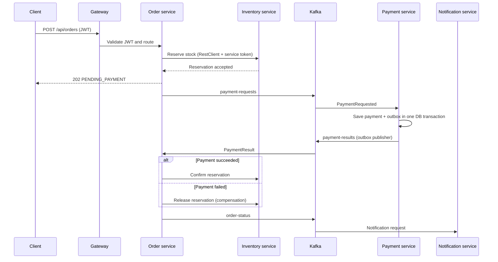

# Ecommerce microservices starter

An independent-service Java 21 / Spring Boot sample for an ecommerce order flow. Each service has its own Gradle settings and build and can be run, tested, and packaged independently. The root build script is a convenience; it does not combine the applications into one runtime.

This is a runnable starter, not a claim of production readiness. It includes a simulated payment adapter, local single-node infrastructure, and example deployment configuration. Production use requires the environment-specific hardening described below.

## Services and communication

| Component | Responsibility | Storage / integration |
|---|---|---|
| `api-gateway` | Authenticated API routing, Redis-backed rate limiting, circuit-breaker fallback | Spring Cloud Gateway |
| `order-service` | Accepts and tracks orders, synchronously reserves inventory, publishes payment requests | MongoDB; RestClient; Kafka |
| `inventory-service` | Maintains available/reserved quantities; idempotent reserve, confirm, and release operations | PostgreSQL |
| `payment-service` | Idempotently records a simulated payment outcome and persists result events in an outbox | Separate PostgreSQL database; Kafka |
| `notification-service` | Consumes order status events and logs a notification request | Kafka |
| `config-server` | Serves centralized YAML configuration from `config/` | Spring Cloud Config native backend |
| `discovery-server` | Local service registry for the Docker Compose setup | Eureka |

Compose uses Eureka load-balanced gateway routes. The Kubernetes example disables Eureka clients and routes through Kubernetes DNS. The services remain independently deployable in both environments.



The distributed transaction is a **Saga**, not a cross-database ACID transaction. Payment outcome events are idempotent by order ID. Payment result publishing uses a database outbox; order requests/status events are retried from persisted order state and are at-least-once. A repeated event can be observed, so consumers must remain idempotent. Inventory reserve/confirm/release operations are idempotent by order ID.

`paymentMethod` values other than `DECLINE`/`FAIL` succeed in the local simulator. This is only a way to exercise success and compensation paths; no payment is charged. `notification-service` currently logs a notification request and does not send email/SMS/push messages.

## Requirements

- Java 21
- Docker Engine with Docker Compose v2
- Gradle 9.8.2

## Build and test

From the repository root:

```sh
./scripts/build-all.sh
```

This runs `clean test bootJar` independently for all seven Gradle applications. A single service can be built with, for example:

```sh
gradle --no-daemon -p order-service test bootJar
```

The GitHub Actions workflow runs the same build on pushes and pull requests. The Jenkinsfile polls its configured SCM every five minutes, builds/tests all services, and publishes images and deploys only from the `main` branch. Configure Jenkins as a Pipeline-from-SCM job pointing at this repository and its `main` branch; multibranch jobs instead need branch indexing/webhook triggers configured in Jenkins. Jenkins agents need Java 21, Gradle 9.8.2, Docker CLI access to a daemon, `kubectl`, the `ghcr-credentials` username/password credential, the `ecommerce-kubeconfig` file credential, and a pre-provisioned cluster/runtime as described under Kubernetes.

## Run locally with Docker Compose

1. Copy `.env.example` to `.env`. The example values are for a private local development stack only; do not reuse them outside a developer machine.
2. Build and start the stack:

   ```sh
   docker compose --env-file .env up --build -d
   ```

3. Wait for services to become healthy. Useful local URLs:
   - Gateway: `http://localhost:8080`
   - Keycloak admin: `http://localhost:8180` (admin credentials from `.env`)
   - Eureka dashboard: `http://localhost:8761`
   - Config Server: `http://localhost:8888`
   - Grafana: `http://localhost:3000` (admin password from `.env`)
   - Jaeger traces: `http://localhost:16686`
   - Prometheus: `http://localhost:9090`

4. In Keycloak's `ecommerce` realm, create a local test user and set a password. The imported `ecommerce-api` public client permits the password grant for local demonstration only. Get a token (replace the test username/password):

   ```sh
   curl -sS -X POST 'http://localhost:8180/realms/ecommerce/protocol/openid-connect/token' \
     -H 'Content-Type: application/x-www-form-urlencoded' \
     --data-urlencode 'client_id=ecommerce-api' \
     --data-urlencode 'grant_type=password' \
     --data-urlencode 'username=local-user' \
     --data-urlencode 'password=replace-me'
   ```

   Copy the `access_token` value from the response and set it locally:

   ```sh
   TOKEN='<access_token>'
   ```

5. Add stock and create an order:

   ```sh
   curl -i -X PUT 'http://localhost:8080/api/inventory/items/BOOK-1' \
     -H "Authorization: Bearer $TOKEN" -H 'Content-Type: application/json' \
     -d '{"sku":"BOOK-1","availableQuantity":20}'

   curl -i -X POST 'http://localhost:8080/api/orders' \
     -H "Authorization: Bearer $TOKEN" -H 'Content-Type: application/json' \
     -d '{"customerId":"customer-1","items":[{"sku":"BOOK-1","quantity":2}],"amount":24.50,"paymentMethod":"DEMO"}'
   ```

   The order endpoint returns `202 Accepted` with the order ID and current state. Poll `GET /api/orders/{id}` through the gateway until it becomes `CONFIRMED`. Set `paymentMethod` to `DECLINE` to exercise the inventory release compensation path. `GET /api/inventory/items` shows available and reserved counts.

Use `docker compose --env-file .env logs -f order-service payment-service inventory-service notification-service` to follow the flow. Stop with `docker compose --env-file .env down`; `down -v` also removes local database/metrics data and should only be used when you intend to delete that development data.

## Kubernetes and Jenkins deployment

`k8s/platform.yaml` deploys the config server, gateway, order, inventory, payment, and notification apps with non-root/read-only containers, bounded resources, probes, and a restricted service account. It does **not** install production databases, Kafka, Redis, OpenTelemetry Collector, Keycloak, or a cloud ingress controller. Before deploying, provision managed or appropriately operated services and make their DNS/credentials available inside the namespace:

- MongoDB, inventory PostgreSQL, and separate payment PostgreSQL
- Kafka cluster with topics `payment-requests`, `payment-results`, and `order-status`, plus producer/consumer ACLs
- Redis for gateway rate limiting
- Keycloak/OIDC issuer reachable from clients and pods, using HTTPS
- OTLP collector and a Prometheus/Grafana/trace backend
- TLS ingress/controller routing to the `api-gateway` ClusterIP service

Create the `ecommerce-runtime` Secret in namespace `ecommerce` before starting application pods. `k8s/runtime-secrets.env.example` lists the required keys; copy it to the ignored `k8s/runtime-secrets.env`, replace every placeholder, and create the secret through your cluster's secret manager or a protected local environment file, for example `kubectl create secret generic ecommerce-runtime --namespace ecommerce --from-env-file=k8s/runtime-secrets.env`. Do not put real values in Git. For a private GHCR package, also create an image pull secret and add it to the pod specs. Configure the `ecommerce-service` confidential client in Keycloak with the secret stored as `service-client-secret`.

The Jenkins main-branch stage publishes seven versioned images to GHCR and applies `k8s/platform.yaml`, then rolls each deployment to the new build tag. Jenkins credentials only authorize that pipeline; this repository does not contain cluster credentials and no live deployment was run here. Verify the Jenkins agent's deployment RBAC restricts it to the intended namespace.

After provisioning an ingress controller and TLS secret, copy `k8s/ingress.example.yaml`, replace its example hostname, and apply it. The ingress is intentionally separate from the Jenkins pipeline so TLS and DNS configuration remain operator-controlled.

## Configuration and security notes

- Central configuration lives in `config/`; Compose mounts it read-only into Config Server. Kubernetes ships an equivalent starter ConfigMap.
- JWTs are issued by Keycloak. Gateway and HTTP services validate tokens, while order-to-inventory calls use the `ecommerce-service` client-credentials token. Kafka authentication is a broker-side responsibility and must be configured with TLS/ACLs in a real environment.
- The Compose realm enables password-grant only for a local test client. Use an OIDC authorization-code flow for end-user applications in production and do not enable password grants for production clients.
- Local Compose dependencies are single-node development services and use development networking/security settings. Do not expose them publicly.
- Rate limiting and Resilience4j defaults are starter values. Tune thresholds, timeouts, concurrency, retries, Kafka retention, outbox cleanup, database pools/indexes, and alerting against measured workload and service-level objectives.
- The sample does not implement role/scope-specific authorization, real card/payment processing, notification delivery, an ingress/TLS policy, persistent Kafka credentials, database backup/restore, or cloud secret-manager integration.
- Inspect logs, dead-letter/retry behavior, outbox backlog, DB migrations, and Saga reconciliation before any production rollout. No universal availability or security claim is made by this sample.

## Repository layout

```text
api-gateway/          Gateway + JWT validation
config-server/        Spring Cloud Config Server
config/               Centralized config-server native repository
discovery-server/     Eureka for Compose/local discovery
inventory-service/    PostgreSQL stock and reservation API
order-service/        Mongo order API + synchronous inventory client
payment-service/      PostgreSQL payment simulator + Kafka outbox
notification-service/ Kafka notification consumer
observability/        OpenTelemetry Collector, Prometheus, Grafana, Jaeger config
k8s/                  Kubernetes application deployments
```
